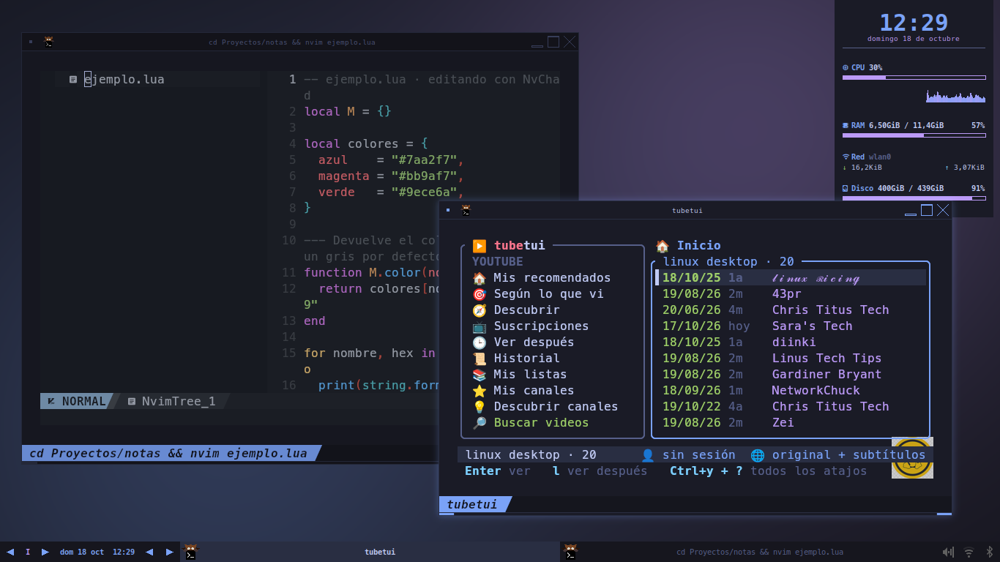
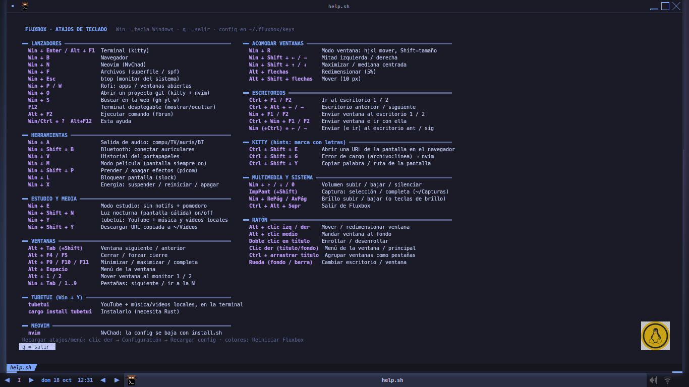
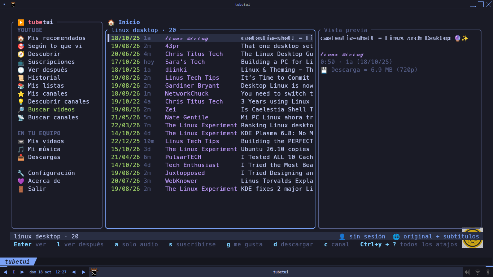
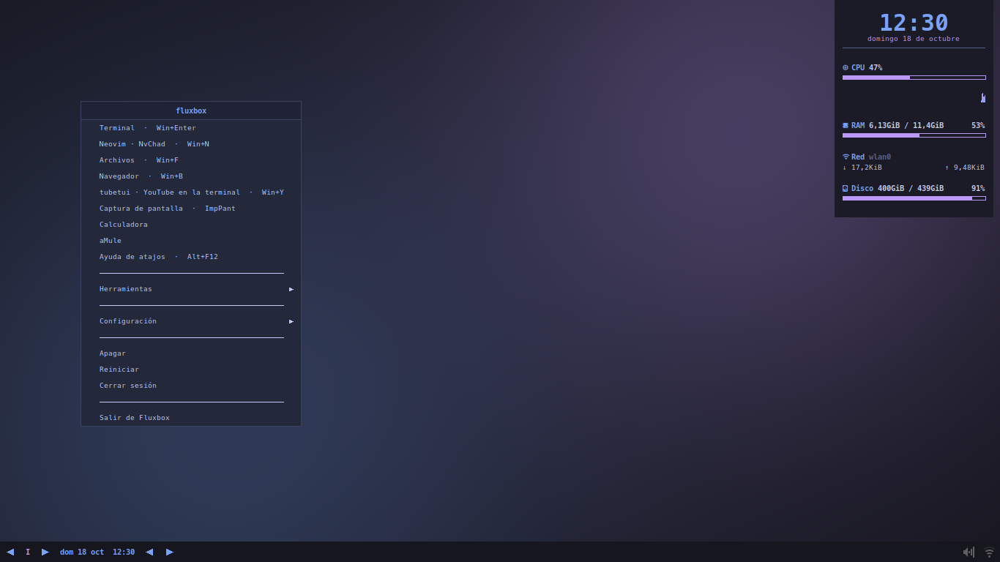
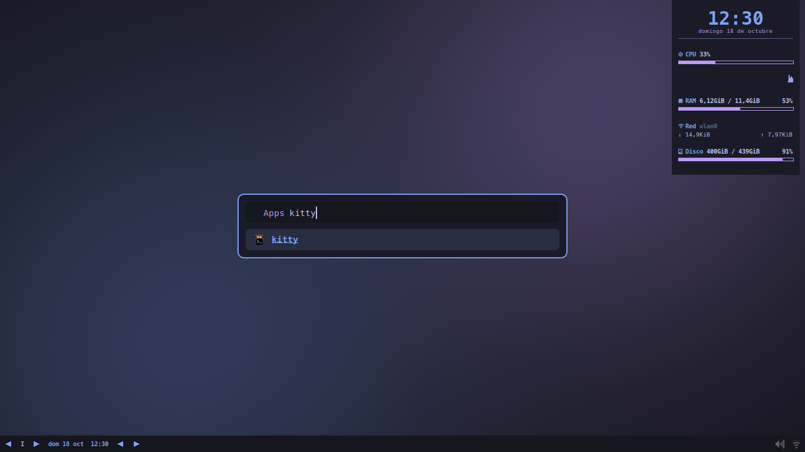
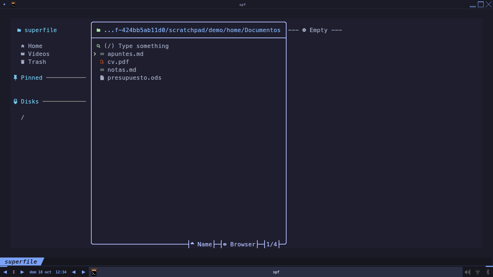
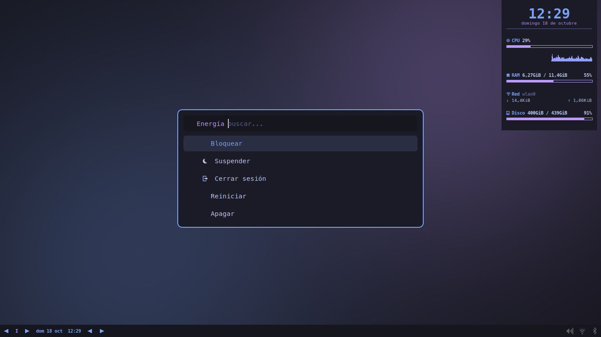
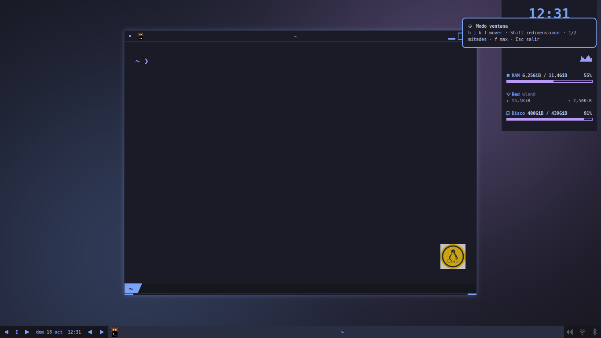
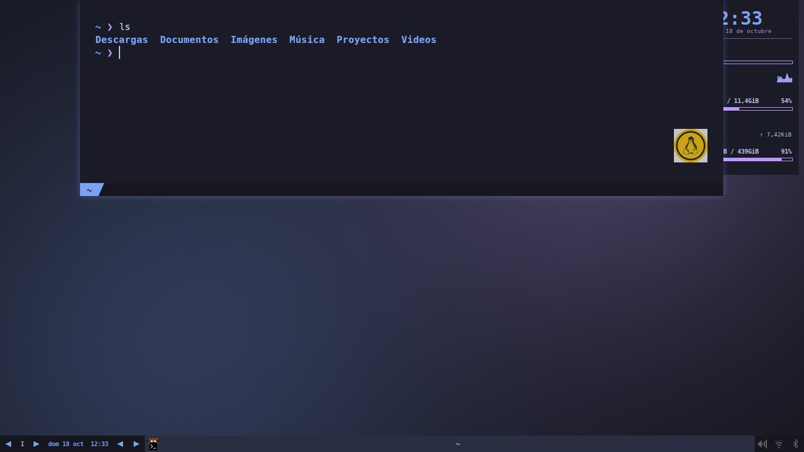

<div align="center">

# fluxbox-optimal

**Un escritorio Fluxbox rápido, pensado para teclado, en Tokyo Night — con [tubetui](https://github.com/polblancoo/tubetui) (YouTube en la terminal) incluido.**

Fluxbox · kitty · rofi · picom · dunst · conky · NvChad · superfile

[English](README.md) · Licencia MIT

</div>

---

## Capturas



| | |
|---|---|
| <br>Chuleta integrada (`Win+?` / `Win+F12`) | <br>tubetui en `Win+Y` |
| <br>Menú principal | <br>Lanzador rofi (`Win+P`) |
| <br>superfile en `Win+F` | <br>Menú de energía (`Win+X`) |
| <br>Modo ventana estilo vim (`Win+R`) | <br>Terminal desplegable (`F12`) |

## Qué trae

- **Tokyo Night en todo**: estilo de Fluxbox, kitty, rofi, dunst y conky.
- **Pensado para teclado**: lanzadores con `Win`, modo ventana estilo vim (`Win+R`), mitades de pantalla, terminal desplegable (`F12`) y una chuleta integrada (`Win+?` o `Win+F12`).
- **tubetui en `Win+Y`**: YouTube, suscripciones, música y videos locales, video integrado en kitty.
- **Scripts útiles** (en `fluxbox/scripts/`, shell simple):
  salida de audio (`Win+A`), menú Bluetooth (`Win+Shift+B`), menú de energía (`Win+X`), modo estudio con pomodoro (`Win+E`), modo película (`Win+M`), luz nocturna, compositor on/off, abrir proyecto (`Win+O`), buscador web (`Win+S`), historial del portapapeles (`Win+V`).
- **Capturas** (`ImpPant`, `Shift+ImpPant`) con flameshot, **brillo** (también `Win+RePág/AvPág`) y **montaje automático de USB** con udiskie.
- **kitty con logo**, pestañas powerline y hints (abrir URLs y errores `archivo:línea` en nvim).
- **Conky básico**: hora, CPU, RAM, red, disco y procesos.
- **NvChad** como editor y **superfile (`spf`)** como gestor de archivos en la terminal (`Win+F`).

## Instalación

Probado en familia Debian/Ubuntu (usa `apt`; en otras distros instalá a mano los paquetes de `packages-apt.txt` y corré el script).

```sh
git clone https://github.com/polblancoo/fluxbox-optimal
cd fluxbox-optimal
./install.sh --dry-run   # mira qué haría
./install.sh
```

El instalador hace backup de lo que reemplaza (`~/.fluxbox.bak-<fecha>`, …), pregunta antes de bajar la fuente Nerd Font o NvChad.
Después cerrá sesión y elegí **Fluxbox** en el login.

### Piezas opcionales (no se instalan solas)

| Herramienta | Cómo |
|---|---|
| tubetui | `cargo install tubetui` (necesita [Rust](https://rustup.rs)) |
| superfile (`spf`) | https://superfile.dev |
| greenclip (portapapeles) | releases de https://github.com/erebe/greenclip |
| aMule | `sudo apt install amule` (ya está en el menú) |
| Fondo | trae uno Tokyo Night; para usar el tuyo copiá una imagen a `~/.fluxbox/wallpaper.jpg` o `.png` |

## Atajos

`Win` = tecla Super. **`Win + ?`** (o `Win + F12`) abre la chuleta completa. Lo principal:

| Teclas | Acción |
|---|---|
| `Win+Enter` / `F12` | terminal / terminal desplegable |
| `Win+P` / `Win+W` | lanzador de apps / selector de ventanas (rofi) |
| `Win+B` / `Win+N` / `Win+F` | navegador / nvim / archivos (spf) |
| `Win+Y` | **tubetui** |
| `Win+R` y `h j k l` | mover ventanas estilo vim |
| `Win+Shift+←/→` | mitad izquierda / derecha |
| `ImpPant` | captura (flameshot) |
| `Win+A` | salida de audio |
| `Win+X` | menú de energía |

> `Win+?` usa el keycode 20, que es la tecla `?` en teclados español/latinoamericano. En otras distribuciones usá `Win+F12` o editá `fluxbox/keys` (el keycode se ve con `xev`).

## Estructura

```
fluxbox/   → ~/.fluxbox    init, keys, menu, apps, startup, styles/, scripts/, help.sh
config/    → ~/.config     kitty, rofi, dunst, picom, conky
install.sh                 instalador (--dry-run, --yes)
packages-apt.txt           lista de paquetes
```

Las rutas usan `$HOME` o un marcador que completa `install.sh`: no hay nada propio de una máquina para editar.

## Créditos

Paleta Tokyo Night de [enkia](https://github.com/enkia/tokyo-night-vscode-theme). Logo: Tux, de Larry Ewing. NvChad, superfile, picom, rofi, flameshot, kitty y Fluxbox son de sus autores.

## Licencia

MIT — ver [LICENSE](LICENSE).
